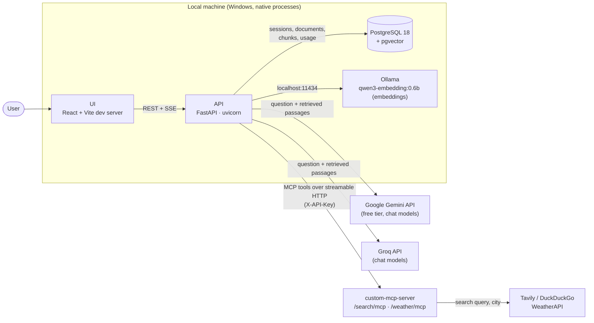
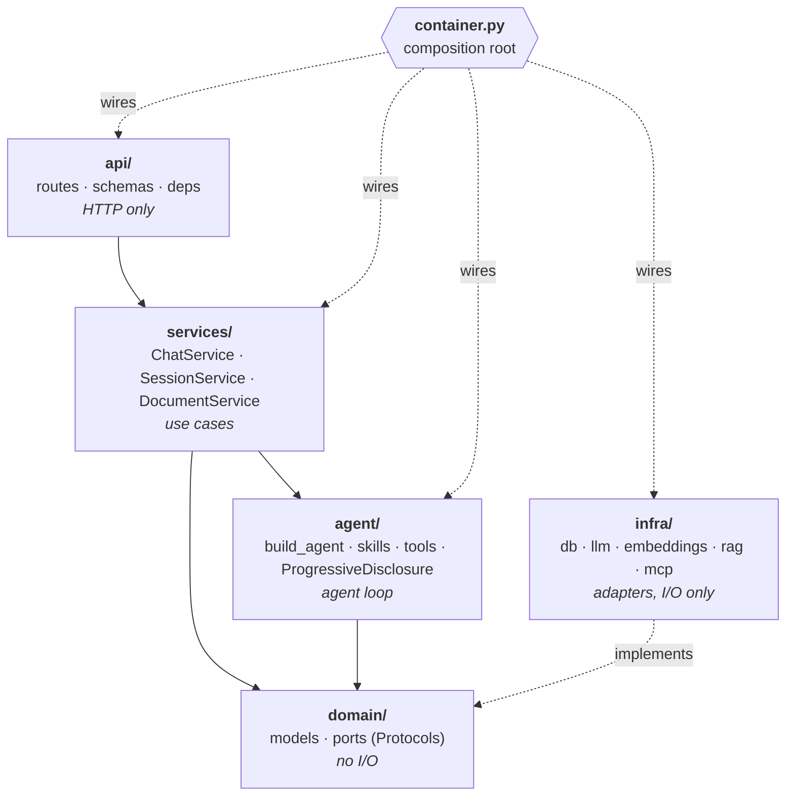
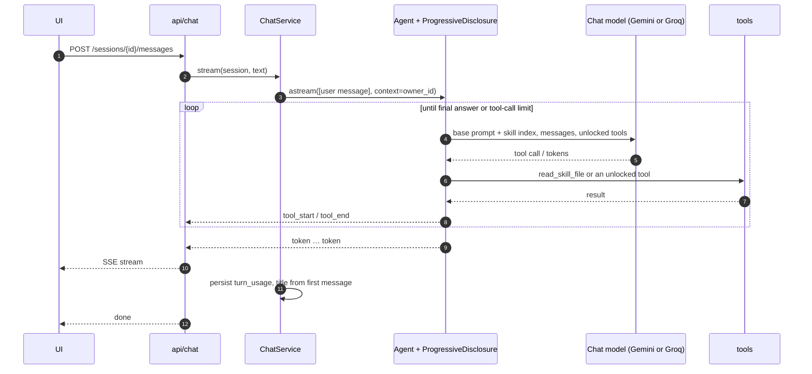
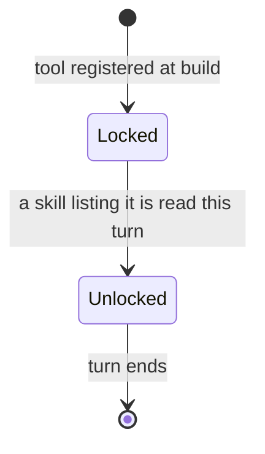
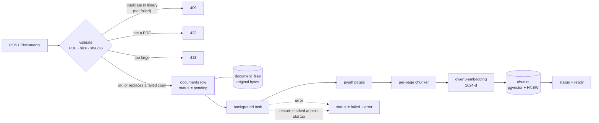
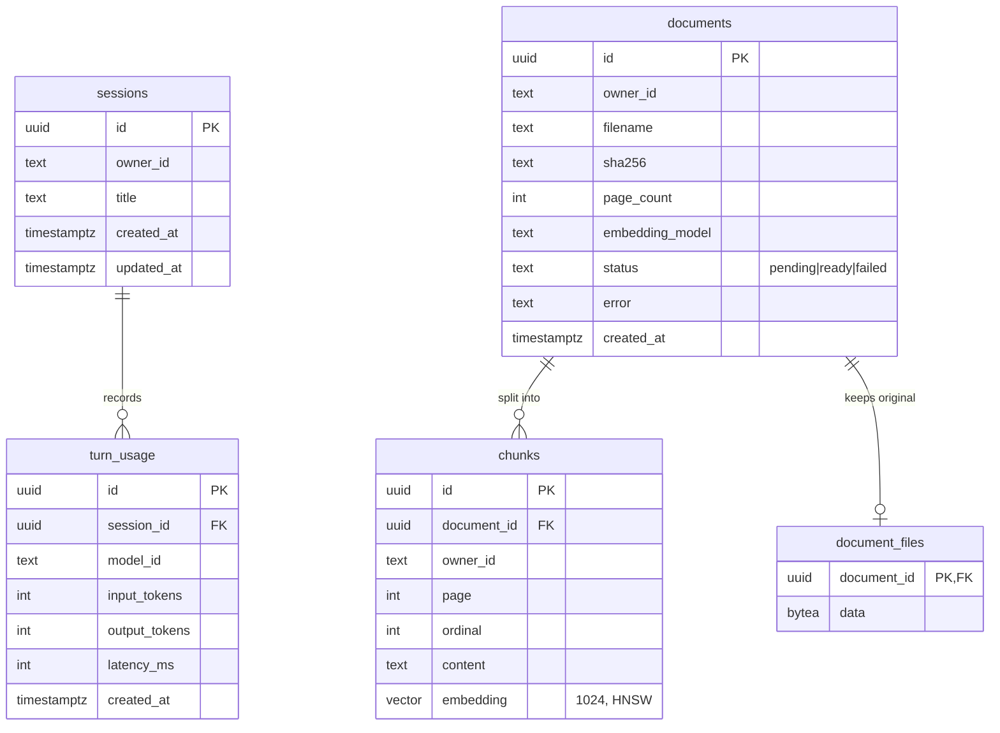

# Architecture

The design and why it is this way. What is implemented right now, file by file, is in [FLOW.md](FLOW.md). Change this file only when the developer approves a design change (see [CLAUDE.md](../CLAUDE.md)).

## TL;DR

- **What:** chat with your PDFs. One agent on a Gemini free-tier or Groq model (chosen per message) answers from a per-owner document library in Postgres + pgvector and cites pages. Web search and weather come from MCP servers (custom-mcp-server), required at startup.
- **Progressive disclosure:** the model starts with a small base system prompt and a one-line index of skills. It reads a skill (`read_skill_file`) before it can use the skill's tools.
- **Layers:** `api → services → domain ← infra`, with `agent` depending only on domain ports. `container.py` is the only module that wires concrete classes.
- **Compact history:** a session's conversation is checkpointed in Postgres. The model sees only the last few earlier questions and answers plus the current turn, never old tool calls or passages.
- **Library, not workspaces:** PDFs are ingested ahead of time, independent of any chat, and every session searches all of the owner's `ready` documents.

---

## System overview

Everything runs natively; there is no Docker locally. Ollama uses the GPU directly, and Postgres runs as a Windows service with pgvector built from source. CI uses a `pgvector/pgvector:pg18` container.

---

## Layers

| Layer | Owns | Must not |
|---|---|---|
| `api/` | Request parsing, response and SSE shaping, status codes | Contain business rules or touch the DB |
| `services/` | Use cases: chat turn, session CRUD, ingestion, search | Import concrete adapters |
| `agent/` | Agent assembly, middleware, skills, local tools | Import concrete adapters |
| `domain/` | Entities, value objects, ports | Do I/O |
| `infra/` | Postgres, pgvector, Ollama, PDF parsing, the MCP client (`mcp/client.py: load_mcp_tools` returns `BaseTool`s that `container.py` passes to `build_agent`) | Decide anything beyond translating I/O |

| Port (`domain/ports.py`) | Adapter (`infra/`) |
|---|---|
| `ChatModelProvider` | `llm/groq.py`, `llm/gemini.py`, selected through `llm/model_factory.py` |
| `Embedder` | `embeddings/ollama.py` |
| `SessionRepository`, `DocumentRepository` (incl. vector search), `UsageRepository` | `db/repositories/*` |
| `UnitOfWork` | `db/unit_of_work.py` |

Ports use `langchain_core` types (`BaseChatModel`, `BaseTool`) directly instead of rewrapping them.

---

## A chat turn

---

## Progressive disclosure

| Layer | Source | The model sees it |
|---|---|---|
| L0 base prompt | `agent/prompts/system.md` | Always, as the start of the system prompt |
| Skill index | frontmatter of every `agent/skills/<name>/SKILL.md` | Always, in place of `{skills}` in the base prompt: one line per skill (name, path, description, tools). Descriptions say what a skill does; which source to prefer is a base-prompt rule |
| L1 skill | `agent/skills/<name>/SKILL.md` | After `read_skill_file("<name>/SKILL.md")` returns it as a tool result. Reading it unlocks the tools in its `allowed-tools` |
| Tools | local (`agent/tools.py`) and MCP (loaded once at startup; an unreachable server or a skill naming a missing tool fails startup) | Only when unlocked by a read skill |

Locked tools are hidden from the model's tool schema, and a call to one is refused, in case the model names it anyway. Skills and tools are separate: a skill says how and when to use tools, a tool does I/O, and `allowed-tools` connects them by name. The format of a skill is fixed by [skill-template/SKILL.md](skill-template/SKILL.md).

---

## Document ingestion

---

## Data model

`documents` is unique on `(owner_id, sha256)`. `chunks.owner_id` is denormalised so every vector search filters by owner without a join. `document_files` is separate so document lists and vector searches never load the bytes; documents uploaded before it existed have no row. Sessions and documents are independent: deleting a session leaves the library untouched.

Conversation history lives in the LangGraph checkpoint tables (`checkpoints`, `checkpoint_blobs`, `checkpoint_writes`), keyed by `thread_id` = the session id. The saver creates them itself at startup, so they are not in Alembic. Deleting a session deletes its thread first.

---

## Key decisions

| # | Decision |
| - | -------- |
| D1 | One agent. LangChain `create_agent` runs only the tool loop; sessions, ingestion and streaming are plain services |
| D2 | The chat model is chosen per message from a catalog (`config/models.yaml`): Gemini free-tier models by default, Groq-hosted models (`qwen/qwen3.8-27b`) as the alternative. Embeddings and the document library stay local on Ollama and Postgres, so only the question and retrieved passages go to Google or Groq. A local 4B Ollama chat model was dropped: it was too weak to read a skill before searching |
| D3 | PostgreSQL 18 + pgvector, native; HNSW cosine index; one embedding model per deployment, stored on each document and checked by `/ready` |
| D4 | Progressive disclosure: base prompt + skill index → `SKILL.md` → tools. A tool is unlocked only by a read skill's `allowed-tools` |
| D6 | Per-session history in a Postgres checkpointer (`thread_id` = session id); the full state is stored, but `ConversationView` shows the model only the last `history_max_turns` earlier questions and final answers plus the whole current turn. Old tool results never reach the model, a follow-up that needs document facts searches again, and switching models mid-session never replays one provider's tool calls to another. A failed turn is saved as an error reply that the model never sees |
| D7 | One document library per owner instead of per-session workspaces (below) |
| D8 | Chunks never cross a page, and retrieval context comes from the same page only, so every citation has one correct page |
| D9 | The owner comes from the server and reaches tools through `AgentContext`, never through tool arguments or the model |
| D10 | Logs carry ids, counts, sizes and durations, never message text, document content or file bytes |
| D11 | The original PDF is kept in Postgres (`document_files`) and served inline (`GET /documents/{id}/file`), so a citation chip opens the browser's own PDF viewer at `#page=N` and every citation can be checked against its source |

### D7: document library instead of per-session workspaces
- **Context:** PDFs were first scoped to the session they were uploaded in. Everything is local, so ingesting once ahead of time is cheap, and the same PDF was being embedded again for every session.
- **Decision:** documents belong to the owner. `POST /documents` ingests a PDF into the library, and every session searches all of the owner's `ready` documents.
- **Consequences:** no per-session document selection; deleting a session keeps its documents, and `DELETE /documents/{id}` removes one. Migration `0004` moved existing rows to their session's owner and kept the earliest copy of duplicated PDFs. Its downgrade deletes all documents because they can't be mapped back to a session.

---

## Extension points

Planned enhancements and where each plugs in:

| Enhancement | Extension point |
|---|---|
| More skills | A new `agent/skills/<name>/SKILL.md` |
| Longer memory than the last few turns | Summarization in `ConversationView` (older turns are forgotten today) |
| Human approval for tools | Human-in-the-loop middleware (the checkpointer already exists) |
| Long-term memory | Memory tools + a skill that lists them + a `memories` table |
| Agent profiles, auto routing | Routing middleware choosing a model per call (today the user picks the model) |
| More chat providers | New provider registered in `ModelFactory` (Gemini and Groq were added) |
| Tracing + evals | Langfuse callback handler; eval datasets |
| Real auth | Replace `DEFAULT_OWNER_ID` with a resolved user in `api/deps.py` |
| In-app viewer with passage highlight | Render the stored original (`GET /documents/{id}/file`) in the app and highlight the cited passage (today the browser viewer opens the page) |
| Resume interrupted ingestion | At startup, re-run `DocumentService.ingest` for `pending` documents from `document_files` instead of marking them failed |
